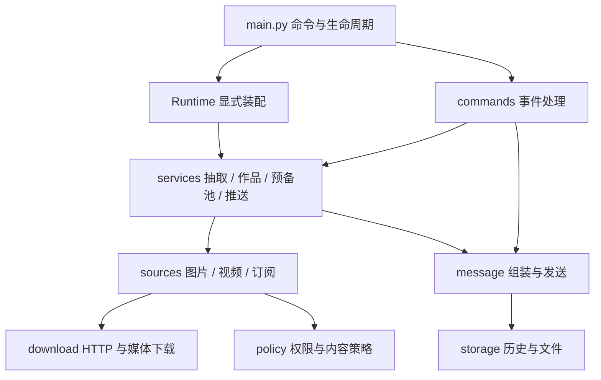

# 项目架构

本项目按职责组织代码，根目录保留 AstrBot 发现插件所需的入口、声明和配置 schema。结构参考 [astrbot_plugin_media_parser](https://github.com/drdon1234/astrbot_plugin_media_parser/tree/5265ff57bf83caa7f5d6a94e7197d0dbd5f6dbf7) 的子系统划分与显式装配方式，并沿用本项目的图片、视频和订阅模型。

```text
astrbot_plugin_random_pic/
├── main.py                     AstrBot 命令注册、无前缀路由、生命周期委托
├── metadata.yaml               插件声明
├── _conf_schema.json           配置面板与默认值的唯一来源
├── requirements.txt            运行依赖
├── core/
│   ├── runtime.py              服务装配、后台任务及资源生命周期
│   ├── paths.py                插件安装根目录与 schema 定位
│   ├── models.py               请求、图集、作品等共享数据模型
│   ├── utils.py                并发、分页、缓存等小型通用函数
│   ├── config/
│   │   ├── settings.py         配置归一化与分组数据对象
│   │   └── migration.py        现有配置布局的原位迁移
│   ├── commands/
│   │   ├── parser.py           命令参数与网站、订阅默认值
│   │   ├── images.py           抽图与别名指令处理
│   │   ├── videos.py           抽视频与发送结果处理
│   │   ├── works.py            回复选作品、全集与 PDF 指令
│   │   ├── reserve.py          管理员刷新预备池
│   │   ├── common.py           事件权限入口、发送回退与反馈
│   │   └── help.py             动态帮助文本
│   ├── services/
│   │   ├── drawing.py          关键词翻译、来源分配、抽取调度
│   │   ├── reserve.py          预备池持久化、补充、借用和刷新
│   │   ├── works.py            作品查询、访问检查与下载生命周期
│   │   ├── push.py             定时调度及主动推送
│   │   └── tags.py             标签数据库与翻译
│   ├── sources/
│   │   ├── base.py             图片、视频、订阅共用的 Source 接口
│   │   ├── images/             图片网站实现与 registry.py
│   │   ├── videos/             视频网站实现、公共筛选与 registry.py
│   │   └── feeds/
│   │       ├── models.py       帖子 Post 与视频 Clip
│   │       ├── base.py         抓帖接口 Feed
│   │       ├── source.py       订阅筛选、近期去重与抽样
│   │       ├── images.py       跨帖图片抽取、整帖作品下载
│   │       ├── videos.py       订阅视频抽取
│   │       ├── telegram.py    Telegram 抓帖实现
│   │       ├── x.py            X 抓帖及索引维护
│   │       └── registry.py     订阅实例与图片、视频来源装配
│   ├── download/
│   │   ├── http.py             HTTP 会话、Cookie、请求错误和限速
│   │   ├── images.py           图片下载、缓存与分页并发下载
│   │   ├── videos.py           视频下载、大小和时长限制、文件清理
│   │   └── hls.py              播放列表、解密、截取及 ffmpeg 封装
│   ├── message/
│   │   ├── types.py            发送模式、类型与异常
│   │   ├── composer.py         图片、视频与合并转发消息组装
│   │   ├── dispatcher.py       逐条发送与消息历史登记
│   │   ├── stage.py            共享文件链接及延迟清理
│   │   └── transport.py        AstrBot 与 OneBot 接口适配
│   ├── storage/
│   │   ├── history.py          会话、消息与作品引用记录
│   │   ├── pdf.py              PDF 缓存、打包、分卷及并发排队
│   │   └── recent.py           最近抽取的内容与作者去重
│   └── policy/
│       ├── access.py           用户、群、分级、冷却与额度
│       └── content.py          内容黑名单、标签过滤与分级复核
├── docs/                       架构与维护文档
└── test/                       本地定向验证，Git 忽略
```

## 运行关系



`Runtime` 是装配点，集中持有共享 HTTP 会话、来源注册表、抽取器、预备池、发送器和存储对象。各命令处理器显式使用同一个运行时；服务不回调插件入口。`RequestParser` 同时服务交互命令、预备池和定时推送，保证订阅默认风格和分级的一致性。

来源注册表分别负责图片、视频和订阅的具体装配，文件名统一为 `registry.py`。包初始化文件只说明职责，不进行自动发现、隐式注册或整包重导出。`Drawer` 只依赖可抽来源和补位来源的最小接口，不依赖某一类具体注册表。视频与订阅可直接复用 `Source`、下载器和近期记录。

类型标注对 `Runtime` 的引用放在 `TYPE_CHECKING` 下，避免处理器与装配点形成运行时循环导入。AstrBot 私有发送接口集中在 `message/transport.py`；其他模块不直接操作这些接口。

## 加载与数据

AstrBot 从根 `main.py` 加载唯一的 `RandomPicPlugin`。全部命令装饰器保留在这个类中，`initialize()` 和 `terminate()` 委托运行时。运行时防止重复启动；卸载时取消并等待预热、推送、补池和订阅回填任务完成清理，再关闭网络与来源资源。并发卸载共用同一关闭任务，调用者取消不会中断清理；一个服务关闭失败时仍尝试关闭其余服务，并允许重试。

配置迁移在入口模块导入期执行，先于 AstrBot 的 schema 清理。`core/paths.py` 根据安装位置定位根 schema 和实际插件目录名，与当前工作目录、内部模块所在层级无关。本次架构调整不增加配置布局或历史导入兼容层，原有配置迁移职责集中保留在 `config/migration.py`。

运行数据仍使用 `StarTools.get_data_dir("astrbot_plugin_random_pic")`，包括发送历史、账号与令牌、标签库、订阅索引、近期记录和默认 PDF 目录。配置共享目录时，图片缓存、视频和预备池仍直接使用共享目录；自定义 PDF 目录仍优先。移动代码不移动这些数据，也不改变 JSON 格式或文件命名。

## 维护约定

- 新增来源：在对应 `sources/images`、`sources/videos` 或 `sources/feeds` 中实现，在该域的 `registry.py` 显式装配；通用下载逻辑放入 `download`。
- 新增命令：根入口保留装饰器与委托，事件流程放入 `commands`；不将站点请求或文件打包写入入口。
- 调整发送行为：排版改 `composer`，平台调用改 `transport`，文件暂存改 `stage`，发送与历史登记改 `dispatcher`。
- 配置字段与默认值只由根 schema 定义；`settings.py` 负责读取与校验，UI 展开开关不进入运行模型。
- 测试统一放根 `test/`，保持 `.gitignore` 的 `/test/` 规则，不跟踪测试、运行数据或临时验证脚本。只验证修改涉及的路径。
- 文件变动直接更新内部导入，不维护旧路径转发文件；具体站点逻辑按实际职责拆分，不为每个站点建立空壳层级。
